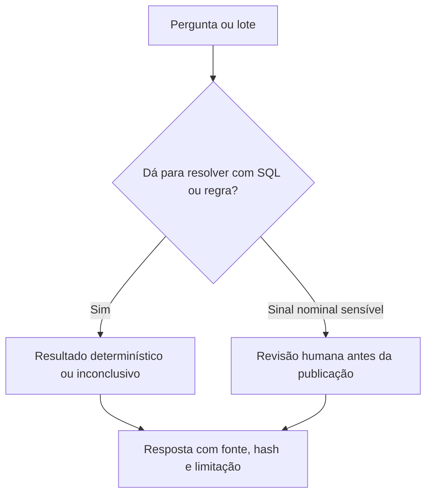

# Arquitetura de análise e de modelos

## Camadas

| Camada | Responsabilidade neste repositório | O que não faz |
| :--- | :--- | :--- |
| A. Regras | `audit/rules.py` valida condições objetivas e emite `AuditSignal` | Não declara irregularidade jurídica |
| B. Estatística | `audit/statistics.py` calcula Z-score, MAD, HHI e Benford em `Decimal` quando o método é monetário ou de contagem | Não converte anomalia em culpa |
| C. Texto ancorado | `audit/rag_narrator.py` monta três blocos a partir do sinal e dos hashes. Recusa narrativa sem proveniência | Não busca um modelo generativo externo nesta árvore |
| D. Triagem | `LayaSystem1Adapter` implementa `DecisionEnginePort` | Não publica sozinho caso nominal com score igual ou acima de 0,70 |
| E. Revisão humana | Status `EM_TRIAGEM_INTERNA` fica invisível ao leitor público | Não foi operada por um revisor humano nesta execução |
| Perguntas públicas | `inquiry/coverage.py` | Não chama modelo e não calcula soma por LLM |

## Laya

O código tenta `import laya`. Se o pacote não estiver instalado, o adaptador usa o identificador `laya-stdlib-calibrated-v1` e uma calibração na biblioteca padrão. O pacote público associado ao nome é o projeto da Convai Innovations publicado em [https://huggingface.co/convaiinnovations/laya](https://huggingface.co/convaiinnovations/laya). A ficha do editor descreve pesos Apache-2.0 e um motor de decisão System 1. Este repositório não inclui os pesos, não fixa um commit de modelo e não executou o benchmark publicado pelo editor.

Os números de acurácia, latência e custo que aparecem na ficha do modelo são medições do próprio editor ou de terceiros citados por ele. Não são resultado deste projeto e não foram repetidos sobre despesa pública brasileira.

## Jev

A mesma ficha cita TypeSafe Jev como API fechada de comparação. Não há cliente Jev, chave, contrato ou medição independente neste repositório. Jev não é dependência e não deve ser descrito como integrado.

## Regras deste produto

- Soma, diferença e contagem de gasto saem de SQL e de `Decimal` / centavos.
- Confiança declarada por um modelo, se um modelo vier a ser ligado, não é probabilidade validada até haver avaliação própria.
- Texto de documento oficial é dado, não instrução. A sanitização está em `privacy.sanitize_untrusted_text`.
- Sem evidência, a resposta pública de `SPEC-0022` usa `ANALISE_INCONCLUSIVA`.
