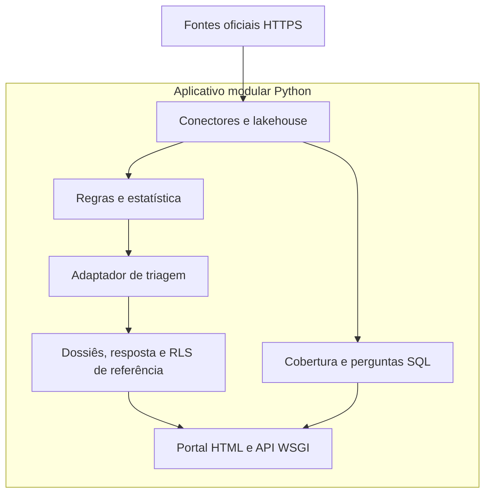

# Arquitetura do sistema

O desenho de contexto anterior permanece em [`system-context.md`](system-context.md). Este arquivo organiza os módulos pedidos para a plataforma sem criar um processo por módulo.

| Módulo pedido | Implementação atual | Processo separado |
| :--- | :--- | :--- |
| Portal público | `wireframe_de_olho_no_brasil.html` servido em `/` | Não |
| API | `deolhonobrasil.api.service` | Não |
| Cadastro de fontes | `get_official_data_source_catalog` | Não |
| Conectores | `pipeline/connectors` e `http_client.py` | Não |
| Preservação do original | diretório `raw/` e `raw_batch_manifests` | Não |
| Extração documental ampla e OCR | Não implementada. Os conectores leem JSON, CSV e registros estruturados | — |
| Normalização | `models.py` e `privacy.py` | Não |
| Motor de regras | `audit/rules.py` e `audit/statistics.py` | Não |
| Orquestração de IA | Adaptador opcional em `laya_engine.py`; perguntas públicas não usam modelo | Não |
| Evidências e revisão | `governance/dossiers.py` | Não |
| Qualidade das fontes | Quarentena, reconciliação e, agora, cobertura observada | Não |
| Colaboração | Direito de resposta e acompanhamentos. Contribuição de código segue `CONTRIBUTING.md` | Não |
| Administração | Rotas com `X-Admin-Token` | Não |

## Stack

A hipótese Next.js, Supabase e Cloud Run não substitui o monólito Python já testado. O banco em execução nos testes é SQLite. O arquivo `rls_policies.sql` prepara políticas PostgreSQL para um Supabase futuro e não está aplicado a um projeto remoto nesta execução.

Docker está em `Dockerfile` e `docker-compose.yml`. Não há diretório Terraform. Introduzir módulos Terraform sem conta, estado remoto e autorização de custo deixaria infraestrutura fictícia.

## Dependências de runtime

`pyproject.toml` declara dependências opcionais (`duckdb`, `polars`, `pydantic`, `httpx`) e de desenvolvimento. A suíte `unittest` da biblioteca padrão não exige instalação delas para os testes que usam somente a stdlib.
