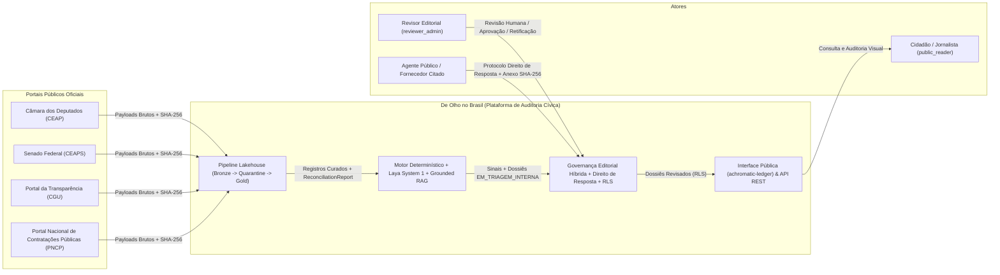

# De Olho no Brasil — Contexto de Sistema e Arquitetura C4

**Versão:** 1.0.0  
**Referências SDD:** `SPEC-0001`, `SPEC-0002`, `SPEC-0003`, `SPEC-0004`

---

## 1. Visão de Contexto (C4 Nível 1)

---

## 2. Módulos Principais do Código (`src/deolhonobrasil/`)

1. **`deolhonobrasil.pipeline`** (`SPEC-0001`):
   - `models.py`: Entidades imutáveis (`frozen=True`) com `ProvenanceMetadata`, `EpistemicClassification`, `CuratedPublicExpense`, `CuratedPublicContract`, `CuratedParliamentaryAmendment`, `QuarantinedRecord` e `BatchReconciliationReport`.
   - `privacy.py`: Validação de CNPJ (Módulo 11), mascaramento LGPD de CPF (`***.XXX.XXX-**`), parsing monetário estrito em `Decimal` e sanitização contra *prompt injection* indireto.
   - `connectors.py`: Conectores determinísticos para CEAP, CEAPS, Emendas CGU e Contratos PNCP.
   - `storage.py`: Persistência transacional SQLite/Parquet (`CivicLakehouseStorage`) com idempotência por chave natural e reconciliação centavo a centavo.
2. **`deolhonobrasil.audit`** (`SPEC-0002`):
   - `statistics.py`: Cálculo paramétrico (`Z-Score`), não-paramétrico (`Modified MAD Z-Score`), concentração de mercado (`Índice HHI` $0..10000$) e conformidade à `Lei de Benford`.
   - `rules.py`: Regras determinísticas auditáveis (`R-PNCP-OVERPRICE-Z3`, `R-CGU-HHI-CONCENTRATION`, `R-CEAP-OUTLIER-Z3`) gerando `AuditSignal`.
   - `laya_engine.py`: Porta `DecisionEnginePort` e adaptador `LayaSystem1Adapter` (`Choice`, `Score`, `Noul`), garantindo que todo `score >= 0.70` exija `REVISAO_HUMANA`.
   - `rag_narrator.py`: Narrador `GroundedDossierNarrator` que estrutura os 3 blocos epistêmicos obrigatórios e recusa execução sem `provenance_hashes`.
3. **`deolhonobrasil.governance`** (`SPEC-0003`):
   - `dossiers.py` & `right_of_reply.py`: Fluxo editorial híbrido (`EM_TRIAGEM_INTERNA` $\rightarrow$ `PUBLICADO_COM_REVISAO` / `ESCLARECIDO_COM_PROVA` / `ERRO_MATERIAL_RETIFICADO`) e Direito de Resposta lado a lado (`equal_visual_prominence=True`).
   - `rls_policies.sql`: Políticas de *Row-Level Security* (RLS) PostgreSQL/Supabase e triggers append-only para `editorial_audit_trail`.
4. **`deolhonobrasil.harness`** (`Eval & SDD Harness`):
   - `runner.py`: Executor do Verification Loop de 6 fases, rastreabilidade SDD (`SPEC-0001..0004`), GateGuard e *Eval Harness* (`pass@k` / `pass^k`).
