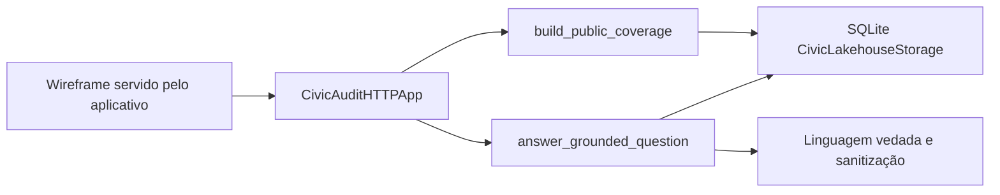

# Plano técnico — SPEC-0022

## Módulos

- `src/deolhonobrasil/inquiry/coverage.py`: agregação e respostas.
- `src/deolhonobrasil/api/service.py`: rotas `GET /api/v1/public-coverage` e `POST /api/v1/questions`.
- `wireframe_de_olho_no_brasil.html`: bloco `#observed-coverage` e rótulos de amostra.
- `tests/test_public_coverage_and_grounded_questions.py`: âncoras `AC-086` a `AC-091`.

## Fluxo

## Fora deste plano

Não há cliente Supabase, worker novo, Terraform apply nem chamada às APIs da Câmara, do Senado, da CGU ou do PNCP.
