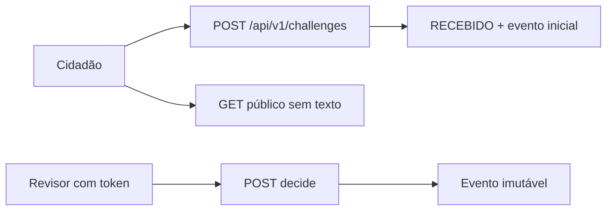

# Plano técnico — SPEC-0023

## Módulos

- `src/deolhonobrasil/governance/challenges.py`
- Tabelas `civic_challenges` e `civic_challenge_events` em `pipeline/storage.py`
- Rotas em `api/service.py`
- Referência PostgreSQL em `governance/rls_policies.sql`
- Formulário `#form-public-challenge` no wireframe

## Fluxo

O navegador não recebe chave de serviço. A política SQL de referência não está aplicada a um banco remoto nesta alteração.
